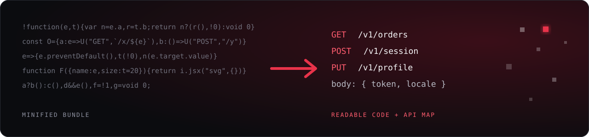
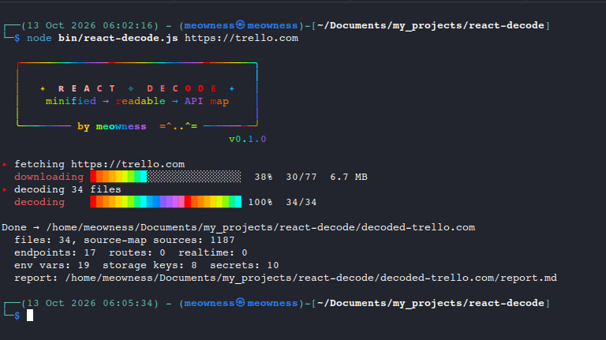
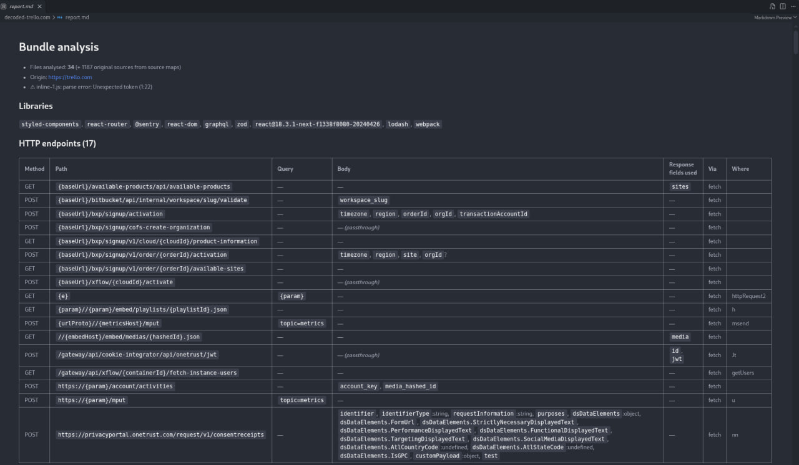

<p align="center">
  
</p>

<h1 align="center">react-decode</h1>

<p align="center">
  <b>Verwandelt minifizierte React-Bundles in lesbaren Code — und holt die API daraus.</b><br>
  Vite · webpack · CRA · Next &nbsp;|&nbsp; statische Analyse, es wird nichts ausgeführt
</p>

<p align="center">
  <a href="README.md">English</a> · <b>Deutsch</b> · <a href="README.ru.md">Русский</a>
</p>

<p align="center">
  
  
</p>

<p align="center">
  
</p>

## Was es macht

Ein Produktions-Bundle ist eine einzige Zeile mit 300 KB. `react-decode` macht es lesbar und beantwortet die
praktischen Fragen: **Welche Requests sendet die App, mit welchen Feldern, was liest sie aus den Antworten,
welche Routen und Schlüssel gibt es?**

| | |
|---|---|
| **Lesbarer Code** | Entminifiziert und formatiert, kurze Namen durch sprechende ersetzt |
| **HTTP-API** | `fetch`, axios, `$.ajax`, XHR, WebSocket, SSE: Methode, Pfad, Query, Body, Header, gelesene Antwortfelder |
| **Extras** | Routen, Env-Variablen, Storage-Keys, GraphQL, Secrets, Bibliotheken, UI-Texte |
| **Eingabe** | URL, `.js`, `.html`, `.map` oder ein Ordner. Folgt Chunks und Source Maps selbstständig |

## Schnellstart

```bash
git clone https://github.com/alexandra-seredkina/React-Decode.git
cd React-Decode && npm install

node bin/react-decode.js https://example.com/           # eine Seite
node bin/react-decode.js ./dist/assets/index-abc123.js  # ein Bundle
node bin/react-decode.js ./build                        # ein Build-Ordner
```

```
decoded-example.com/
├── report.md      Endpunkte, Routen, Env, Secrets, Bibliotheken …
├── decoded/       lesbarer Code jedes Bundles
└── src/           Originalquellen, falls eine Source Map gefunden wurde
```

<p align="center">
  
</p>

## Beispiel

**Vorher**

```js
const api={listUsers:(e,t)=>a.get("/users",{params:{page:e,per_page:t}}),
createUser:e=>a.post("/users",{name:e.name,email:e.email,admin:!1})};
async function load(){const{data:e}=await api.getUser(7);return e.profile.avatar_url}
```

**Nachher**

```js
const api = {
  listUsers: (page, per_page) => a.get('/users', { params: { page, per_page } }),
  createUser: (e) => a.post('/users', { name: e.name, email: e.email, admin: false }),
};
async function load() {
  const { data } = await api.getUser(7);
  return data.profile.avatar_url;
}
```

**`report.md`**

| Methode | Pfad | Query | Body | Gelesene Antwortfelder |
|---|---|---|---|---|
| GET | `/users` | `page`, `per_page` | — | `data.items` |
| POST | `/users` | — | `name`, `email`, `admin`:boolean | — |
| GET | `/users/{userId}` | — | — | `data.profile.avatar_url` |

> Die meisten Apps rufen `fetch` nie direkt auf. Sie haben eine Hilfsfunktion `request(method, path, body)` und
> ein `api`-Objekt darum herum. `react-decode` findet solche Wrapper in beliebiger Tiefe und löst jeden Aufruf
> zu einer konkreten URL auf.

<p align="center">
  report.md</code>" width="100%">
</p>

## Optionen

| Flag | Beschreibung |
|---|---|
| `-o, --out <dir>` | Ausgabeordner (Standard `./decoded-<name>`) |
| `-H, --header "K: V"` | zusätzlicher Request-Header für entfernte Eingaben (wiederholbar) |
| `--no-chunks` | dynamischen Chunks nicht folgen |
| `--max-files <n>` | Limit heruntergeladener Dateien (Standard 150) |
| `--no-rename` | minifizierte Namen behalten |
| `--no-prettier` | prettier überspringen |
| `--json` | vollständige Analyse nach stdout (Secrets unmaskiert) |
| `-q, --quiet` | keine Fortschrittsausgabe |

```bash
node bin/react-decode.js https://staging.example.com/ -H "Cookie: session=…" -o out
node bin/react-decode.js ./dist -q --json | jq -r '.endpoints[] | "\(.method) \(.path)"'
```

## Grenzen

- Statische Analyse: Werte aus Variablen bleiben `{param}`, Typen sind geschätzt.
- Query-Aufbau über `new URL().searchParams` oder `qs.stringify` wird nicht erkannt.
- Control-Flow-Flattening und String-Array-Obfuskation werden nicht rückgängig gemacht.

## Verantwortungsvolle Nutzung

Das Tool liest, was eine Seite ohnehin an jeden Browser ausliefert. Analysiere eigene Apps oder solche, deren
Untersuchung dir erlaubt ist, und beachte die Regeln des Dienstes.

## Lizenz

MIT — siehe [LICENSE](LICENSE). Tests: `npm test`.
